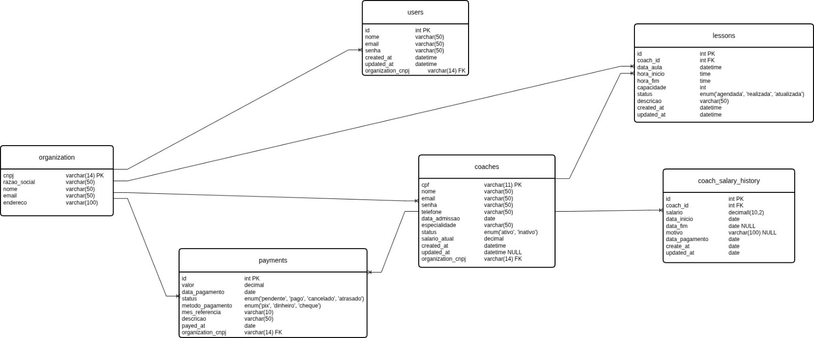

# Estrutura do Banco de Dados
O banco é estruturado em torno das seguintes entidades: 

`organization` — a unidade fitness cadastrada no sistema (ex.: LCKR Training Club), preparando o sistema para eventualmente atender mais de uma unidade. 
`users` — contas de acesso ao sistema, usadas pela secretaria e pela administração. 
`coaches` — cadastro dos professores, vinculados a uma organization. 
`lessons` — aulas ministradas, vinculadas a um coach. 
`payments` — pagamentos gerados a partir das aulas registradas. 
`coach_salary_history` — histórico de valores pagos por aula a cada `coach`, permitindo rastrear mudanças de valor ao longo do tempo sem sobrescrever o registro anterior. 

# Modelo lógico e relacional
